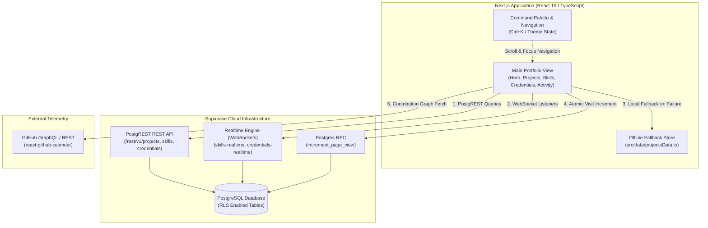

# Rhodge Esperon — Systems & AI Portfolio

> Telemetry-driven personal developer portfolio and systems engineering showcase built with Next.js 16, React 19, TypeScript, Tailwind CSS v4, and Supabase Realtime.

<p align="center">
  
  
  
  
  
  
</p>

<p align="center">
  <a href="https://esperonrhodge.vercel.app">
    
  </a>
  
  
  
</p>

---

## Overview

This repository powers the personal portfolio and systems engineering showcase of **Rhodge Ellio D. Esperon** (`@0xriyoru`), an AI & Full-Stack Developer and 4th-year BS Information Technology student at Lyceum of Subic Bay.

The platform is designed around an **Obsidian Dark-Tech & Living Telemetry** design philosophy—blending precision engineering metrics with an interactive web experience. Unlike conventional static CV websites, the portfolio pairs client-side rendering with live backend synchronization via Supabase, presenting real-time project states, credential records, interactive GitHub activity streams, and an atomic visitor counter.

### Core Objectives & Highlights

- **Production-Grounded Case Studies**: Surfaces real-world systems including internal government infrastructure deployed at the Subic Bay Metropolitan Authority (**SBMA-JO**), OCR-assisted media translation engines (**MEKAI**), low-latency Web Audio sampler launchpads (**REBEAT**), and collaborative Progressive Web Apps (**ARTNEST**).
- **Hybrid Data Pipeline**: Queries remote Supabase tables via PostgREST and subscribes to Realtime WebSocket events, with zero-latency fallback to static TypeScript definitions for offline resilience.
- **Precision Dark-Tech Aesthetics**: Utilizes deep zinc and obsidian backgrounds, glassmorphic card overlays, radial canvas ambient grids, and dynamic typography pairings (Inter for readability with JetBrains Mono for system metrics).

---

## Tech Stack

| Area | Technology | Usage & Responsibility |
| :--- | :--- | :--- |
| **Framework** | Next.js 16.3.4 (App Router) | Client application scaffolding, routing, and static output generation (`output: 'export'`) |
| **Runtime & Language** | React 19.2.8 & TypeScript 5 | Component architecture, strict typing, and modern concurrent UI rendering |
| **Styling & Design Tokens** | Tailwind CSS v4 & PostCSS | Micro-tokens, custom utility glassmorphism, responsive CSS variables, and layout styles |
| **Animations & Motion** | Framer Motion 13.1.1 | Telemetry transitions, layout morphing, bootloader sequencing, and modal animations |
| **Database & Backend** | Supabase (PostgreSQL 15+) | Cloud persistence, Row-Level Security (RLS) policies, and atomic Postgres RPC functions |
| **Realtime Engine** | `@supabase/supabase-js` 2.112.4 | WebSocket subscriptions on `skills` and `credentials` database tables |
| **Telemetry & Visuals** | `react-github-calendar` | Real-time GitHub commit matrix visualization with multi-year filter support |
| **Fonts** | `next/font/google` | Font optimization for Inter, JetBrains Mono, Orbitron, and Chakra Petch |

---

## Features

### 1. Interactive Telemetry Hero (`src/app/page.tsx`)
- **Live Local Time**: Formatted for Manila timezone (`Asia/Manila`, UTC+8) with per-second ticker updates.
- **Geographic Coordinates**: Displays Subic Bay, Philippines coordinates (`14.8219° N, 120.2712° E`).
- **Interactive Visualizers**: Includes HUD radar telemetry (`CyberHudRadar.tsx`), decrypting scramble text (`ScrambleText.tsx`), animated stats grid (`AnimatedStatsGrid.tsx`), and availability indicators.
- **Quick Jump Actions**: Smooth scrolling to showcase sections, CV access (`public/cv.html`), and direct email contact.

### 2. Live Synchronized Project Matrix (`src/components/Projects.tsx`)
- Fetches project metadata directly from the `projects` table in Supabase, merged seamlessly with offline fallback data (`src/data/projectsData.ts`).
- Filterable by project deployment status (`ALL`, `DEPLOYED`, `DEVELOPMENT`, `ARCHIVED`).
- Rich project cards showing production domains, architectural highlights, and tech stacks.

### 3. Realtime Skills & Credentials (`src/components/Skills.tsx`, `src/components/Credentials.tsx`)
- Subscribes to Supabase Realtime channels (`skills-realtime` and `credentials-realtime`) for instant UI synchronization when database records change.
- Categorized skill toolkits spanning Front-End, Back-End & Databases, Agentic AI, and UI/UX Systems Design.
- Filterable milestone timeline covering industry internships (SBMA), national hackathons, and enterprise seminars.

### 4. Interactive GitHub Activity Transmission (`src/components/Activity.tsx`)
- Live GitHub contribution calendar integration powered by `react-github-calendar`.
- Interactive year selector allowing visitors to view contributions across `PAST 1Y`, `2026`, `2025`, and `2024`.
- Automatic light/dark palette syncing via theme mutation observers.

### 5. Keyboard-First Command Palette (`src/components/CommandPalette.tsx`)
- Global `Ctrl + K` / `Cmd + K` keyboard trigger.
- Instant search filter for deep section navigation, contact actions (one-click email copy to clipboard), and immediate theme switching.

### 6. Tri-State Theme Engine & Telemetry Bootloader
- **Theme Switcher (`ThemeToggle.tsx`)**: Seamlessly toggles between `DARK`, `LIGHT`, and `AUTO` (system preference) with `localStorage` persistence and cross-tab synchronization.
- **Boot Sequence (`CyberBootLoader.tsx`)**: Ambient 2.2-second telemetry bootloader simulating core initialization before revealing the interactive interface.
- **Atomic Page View Counter (`PageViews.tsx`)**: Secure visitor view tracking utilizing the PostgreSQL `increment_page_view()` RPC function.

---

## Architecture

The application adopts a static-export architecture coupled with client-side cloud data hydration:



### Architectural Responsibilities

- **Static Frontend**: Pre-rendered via Next.js static export (`output: 'export'`) to maximize Edge CDN caching, ensure near-zero TTFB (Time to First Byte), and prevent server execution bottlenecks.
- **Data Hydration**: On client mount, components query Supabase PostgREST endpoints. In environments where credentials are not provisioned or offline, the interface falls back to hardcoded production records in `src/data/projectsData.ts`.
- **Database Security**: All Postgres tables enforce Row-Level Security (RLS) restricting public anonymous access to `SELECT` operations, while the page view counter executes through a single `SECURITY DEFINER` stored procedure.

---

## Project Structure

```text
esperon-portfolio/
├── docs/                                 # Architectural specifications and redesign documentation
│   ├── agents/                           # Agent convention guidelines (domain, issue tracking)
│   └── superpowers/                      # UI specifications and implementation plans
├── public/                               # Static assets and browser deliverables
│   ├── cv.html                           # Standalone HTML CV / Resume document
│   ├── profile.png                       # Primary avatar graphic
│   └── sounds/                           # Audio sound effects for UI micro-interactions
├── src/
│   ├── app/                              # Next.js App Router root
│   │   ├── globals.css                   # Tailwind CSS v4 directives, custom themes & chamfers
│   │   ├── layout.tsx                    # Root HTML layout, font bindings, and telemetry wrapper
│   │   └── page.tsx                      # Main single-page portfolio layout & section orchestration
│   ├── components/                       # Modular UI components
│   │   ├── Activity.tsx                  # Interactive GitHub contribution calendar
│   │   ├── AnimatedStatsGrid.tsx         # Telemetry statistics matrix
│   │   ├── CommandPalette.tsx            # Global keyboard command menu (Ctrl+K)
│   │   ├── Credentials.tsx               # Career milestones, hackathons, and certifications
│   │   ├── CyberBackgroundCanvas.tsx     # Animated HTML5 canvas background
│   │   ├── CyberBootLoader.tsx           # Telemetry bootloader sequence
│   │   ├── CyberHudRadar.tsx             # Interactive decorative HUD radar element
│   │   ├── MobileNav.tsx                 # Responsive mobile drawer navigation
│   │   ├── PageViews.tsx                 # Atomic visitor counter pill
│   │   ├── PageWrapper.tsx               # Layout motion wrapper
│   │   ├── Projects.tsx                  # Featured project grid with status tabs
│   │   ├── ScrambleText.tsx              # Hacker text decrypter animation
│   │   ├── Sidebar.tsx                   # Fixed desktop navigation sidebar
│   │   ├── Skills.tsx                    # Categorized technical inventory
│   │   └── ThemeToggle.tsx               # Tri-state theme switcher (Dark, Light, Auto)
│   ├── data/
│   │   └── projectsData.ts               # Offline fallback project data definitions
│   └── lib/
│       └── supabase.ts                   # Supabase client singleton initialization
├── supabase/                             # Database migrations and seed definitions
│   ├── migrations/
│   │   └── 20260902000000_init_schema.sql # Postgres tables, RLS policies, and RPC function
│   ├── config.toml                       # Local Supabase CLI configuration
│   └── seed.sql                          # Seed data for projects, credentials, and skills
├── next.config.ts                        # Next.js configuration (static export setup)
├── package.json                          # Manifest dependencies and operational scripts
└── tsconfig.json                         # TypeScript compiler options & path aliases
```

---

## Getting Started

### Prerequisites

- **Node.js**: `v20.x` or later
- **npm**: `v10.x` or later (or equivalent package manager compatible with `package-lock.json`)

### Installation

1. Clone the repository:
   ```bash
   git clone https://github.com/0xriyoru/esperon-portfolio.git
   cd esperon-portfolio
   ```

2. Install dependencies:
   ```bash
   npm install
   ```

### Configuration

Create a local environment file `.env.local` in the project root:

```env
# Public Supabase API Gateway URL
NEXT_PUBLIC_SUPABASE_URL=

# Public Supabase Anonymous / Publishable Key
NEXT_PUBLIC_SUPABASE_PUBLISHABLE_KEY=
```

> [!NOTE]
> If environment variables are omitted or invalid, the application gracefully falls back to bundled static data in `src/data/projectsData.ts`, ensuring the portfolio remains fully viewable during local development without a database connection.

### Running Locally

Start the local development server:

```bash
npm run dev
```

Open [http://localhost:3000](http://localhost:3000) in your browser to inspect the application.

---

## Database & Supabase Setup

The project includes declarative SQL migrations under `supabase/migrations/` and initial records in `supabase/seed.sql`.

### Schema Summary

1. **`projects`**: Project titles, summaries, architectural highlights, tags, deployment domains, and status (`DEPLOYED`, `DEVELOPMENT`, `ARCHIVED`).
2. **`credentials`**: Professional work history, certifications, summits, and hackathons with verified organization links and skills acquired.
3. **`skills`**: Categorized technical skills sorted by display order.
4. **`page_views`**: Single-row atomic counter table updated exclusively through the `increment_page_view()` stored procedure.

### Applying Migrations via Supabase CLI

If managing a local or remote Supabase instance:

```bash
# Start local Supabase containers (requires Docker)
npx supabase start

# Apply database migrations
npx supabase db push

# Apply seed dataset
npx supabase db reset
```

---

## Available Scripts

| Command | Action |
| :--- | :--- |
| `npm run dev` | Starts the Next.js development server on `http://localhost:3000` with hot reloading |
| `npm run build` | Compiles the application and generates static HTML/JS/CSS assets into the `out/` directory |
| `npm run start` | Starts a Node.js production web server (for non-static deployments) |
| `npm run lint` | Runs ESLint 9 across all project source files to verify syntax and code style |

---

## Deployment

The application is configured for **Static HTML Export** in `next.config.ts`:

```typescript
import type { NextConfig } from "next";

const nextConfig: NextConfig = {
  output: 'export',
  images: {
    unoptimized: true,
  },
};

export default nextConfig;
```

Running `npm run build` generates a standalone `out/` folder containing pre-rendered HTML, JavaScript bundles, and static assets. This build output can be hosted on any static hosting provider:

- **Vercel**: Deploy the repository directly or via the Vercel CLI (configured as Next.js static export).
- **Cloudflare Pages**: Connect the Git repository and set the build command to `npm run build` with the output directory set to `out`.
- **GitHub Pages**: Build and deploy the generated `out/` directory to the `gh-pages` branch.

---

## Author & Contact

**Rhodge Ellio D. Esperon**  
*AI & Full-Stack Developer*

- **Website / Portfolio**: [esperonrhodge.vercel.app](https://esperonrhodge.vercel.app)
- **GitHub**: [@0xriyoru](https://github.com/0xriyoru)
- **LinkedIn**: [linkedin.com/in/rhodge-esperon](https://www.linkedin.com/in/rhodge-esperon)
- **Email**: [rhodgesperon@gmail.com](mailto:rhodgesperon@gmail.com)
- **Location**: Olongapo City / Subic Bay, Philippines (UTC+8)
