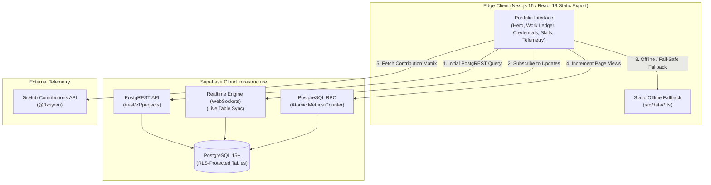

# Rhodge Esperon — Systems & Front-End Developer

  
  
  
  

  
  
  
  

---

## Executive Profile

I am a **Systems and Front-End Developer** based in Olongapo City, Philippines, combining rigorous database architecture and systems engineering with precise, accessible UI craft.

My engineering work emphasizes verifiable production deliverables: transitioning mission-critical enterprise workflows to secure cloud environments, engineering performant static architectures with real-time hydration, and designing high-legibility, distraction-free software interfaces.

---

## Featured Engineering Deliverables

### 1. Enterprise Job Order Management System & Cloud Migration
**Client / Organization:** Subic Bay Metropolitan Authority (SBMA) — Asset Management Department (AMD)  
**Period:** May 2026 – September 2026

* **Problem:** AMD operations relied on an unmaintained, vulnerable local-host application with data-loss risks, lack of audit trails, and fragmented maintenance requests across port facilities.
* **Architecture & Solution:** Engineered a full-stack, cloud-based Job Order Management System featuring atomic serial tracking, role-based authorization, and real-time operational KPI dashboards.
* **Impact:** Eliminated operational bottlenecks across equipment tracking, provided tamper-proof audit trails for government compliance, and safeguarded critical facility records through automated cloud backups and strict access governance.

---

### 2. Competitive Programming & Regional Tech Summit Recognition
**Events:** RAITE 2026 Regional Programming Competition, DEVCON Convergence III, AWS Community Day PH

* **Regional Programming Competition (RAITE 2026):** Represented Lyceum of Subic Bay in algorithmic problem-solving, data structures, and computational optimization against top university teams across Region III.
* **Industry Summit Participation:** Active contributor across DEVCON Convergence III (Full-Stack & Cloud Architecture) and AWS Community Day Philippines, evaluating serverless scaling patterns and modern distributed cloud paradigms.
* **Verified Credentials:** Official certificates and credentials cataloged and verifiable on the [live portfolio credentials ledger](https://esperonrhodge.vercel.app/#experience).

---

### 3. Field Notebook Design System & Zero-Server Web Architecture
**Implementation:** [`src/app/globals.css`](file:///c:/Users/Riyoru/Documents/rhodge-multiverse/projects/esperon-portfolio/src/app/globals.css), [`src/components/Projects.tsx`](file:///c:/Users/Riyoru/Documents/rhodge-multiverse/projects/esperon-portfolio/src/components/Projects.tsx), [`src/lib/supabase.ts`](file:///c:/Users/Riyoru/Documents/rhodge-multiverse/projects/esperon-portfolio/src/lib/supabase.ts)

* **Design Philosophy:** Rejects gamified web elements, dark-mode gimmicks, and bloated 3D shaders in favor of a disciplined paper-and-ink aesthetic (`#edeff2` paper, `#12151a` ink, `#2340d9` cobalt). Built for rapid recruiter scanning with high-legibility typefaces (Bricolage Grotesque and Geist) and crisp 1px structural boundaries.
* **Static Edge Compilation:** Compiles to zero-server static HTML/CSS/JS (`output: 'export'`) distributed via Vercel Edge CDN for instant TTFB (<50ms) and zero server compute overhead.
* **Resilient Supabase Hydration:** Hydrates client-side via Supabase PostgREST endpoints and WebSockets (`projects-realtime` channel) with seamless, zero-latency fallback to offline static TypeScript dictionaries ([`src/data/projectsData.ts`](file:///c:/Users/Riyoru/Documents/rhodge-multiverse/projects/esperon-portfolio/src/data/projectsData.ts)) if external networks fail.

---

## Technical Competencies

| Domain | Core Technologies & Practices |
| :--- | :--- |
| **Front-End Architecture** | React 19, Next.js 16 (App Router, Static Export), TypeScript 5, Tailwind CSS v4, Motion |
| **Back-End & Systems** | PostgreSQL 15+, Supabase, PostgREST, REST API Design, Row-Level Security (RLS), Cloud Database Migrations |
| **UI/UX Engineering** | Design Token Architecture, Responsive Layouts, Accessibility (a11y), High-Density Data Grids, Typography Systems |
| **DevOps & Tooling** | Git, GitHub, Edge CDN Deployment (Vercel), ESLint, Supabase CLI, Atomic Stored Procedures (PL/pgSQL) |

---

## System Architecture

The portfolio pairs zero-server static hosting with reactive cloud data synchronization:

---

## Key Codebase Navigation

For technical recruiters and engineering leads reviewing the codebase:

* [`src/app/page.tsx`](file:///c:/Users/Riyoru/Documents/rhodge-multiverse/projects/esperon-portfolio/src/app/page.tsx) — Main page assembly, hero line-mask reveals, and section orchestration.
* [`src/components/Projects.tsx`](file:///c:/Users/Riyoru/Documents/rhodge-multiverse/projects/esperon-portfolio/src/components/Projects.tsx) — Expandable project index with Supabase Realtime synchronization and offline data fallbacks.
* [`src/components/Credentials.tsx`](file:///c:/Users/Riyoru/Documents/rhodge-multiverse/projects/esperon-portfolio/src/components/Credentials.tsx) — Chronological competition, seminar, and certificate ledger with direct document links.
* [`src/components/Skills.tsx`](file:///c:/Users/Riyoru/Documents/rhodge-multiverse/projects/esperon-portfolio/src/components/Skills.tsx) — Categorized technical skill taxonomy and ecosystem links.
* [`src/lib/supabase.ts`](file:///c:/Users/Riyoru/Documents/rhodge-multiverse/projects/esperon-portfolio/src/lib/supabase.ts) — Client singleton initialization for Supabase PostgREST and Realtime channels.
* [`supabase/migrations/`](file:///c:/Users/Riyoru/Documents/rhodge-multiverse/projects/esperon-portfolio/supabase/migrations/) — Declarative PostgreSQL table schemas, Row-Level Security policies, and stored procedures.

---

## Contact & Professional Links

* **Live Portfolio:** [esperonrhodge.vercel.app](https://esperonrhodge.vercel.app)
* **Direct Curriculum Vitae:** [Download CV (PDF)](https://esperonrhodge.vercel.app/cv.pdf)
* **LinkedIn:** [linkedin.com/in/rhodge-esperon](https://www.linkedin.com/in/rhodge-esperon)
* **GitHub:** [@0xriyoru](https://github.com/0xriyoru)
* **Email:** [rhodgesperon@gmail.com](mailto:rhodgesperon@gmail.com)
* **Location:** Olongapo City / Subic Bay Freeport Zone, Philippines (UTC+8)
