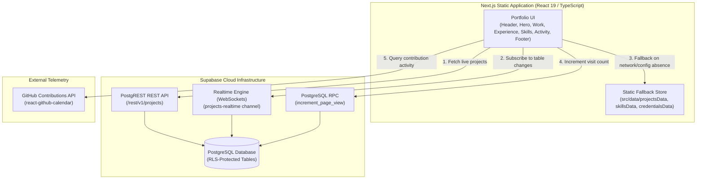

# Rhodge Esperon — Systems & Front-End Developer Portfolio

> Personal developer portfolio and systems engineering showcase built with Next.js 16, React 19, TypeScript, Tailwind CSS v4, and Supabase. Designed around the Field Notebook design system for technical recruiters and hiring managers.

<p align="center">
  
  
  
  
  
  
</p>

<p align="center">
  <a href="https://esperonrhodge.vercel.app">
    
  </a>
  
  
  
</p>

---

## Overview

This repository contains the source code for the personal portfolio of **Rhodge Ellio D. Esperon** (`@0xriyoru`), an IT Student at Lyceum of Subic Bay, Systems and Front-End Developer, and UI/UX Designer based in Olongapo City, Philippines.

The application is styled with the **Field Notebook** design system—a disciplined, paper-and-ink aesthetic (`#edeff2` paper, `#12151a` ink, and `#2340d9` cobalt accent) calibrated specifically for technical recruiters and engineering leads. It rejects artificial gamification, dark-mode toggles, and heavy canvas shaders in favor of high-legibility typography (Bricolage Grotesque and Geist), crisp 1px structural rules, instant content scanning, and verifiable engineering credentials.

Under the hood, the frontend compiles to a zero-server static export (`output: 'export'`) deployed to Vercel, paired with client-side Supabase data hydration for real-time project updates and atomic visitor metrics, backed by static TypeScript fallbacks for offline reliability.

---

## Tech Stack

| Area | Technology | Usage & Responsibility |
| :--- | :--- | :--- |
| **Framework** | Next.js 16.3.4 (App Router) | Static site generation (`output: 'export'`), route management, and font optimization |
| **Runtime & Language** | React 19.2.8 & TypeScript 5 | Strict-typed component architecture and concurrent UI rendering |
| **Styling & Design Tokens** | Tailwind CSS v4 & PostCSS | Notebook color tokens (`paper`, `ink`, `accent`), 1px structural rules, and responsive layouts |
| **Motion & Interaction** | Framer Motion 13.1.1 & CSS Keyframes | Authored hero mask reveal, scroll progress spring bar, and viewport entry reveals with reduced-motion support |
| **Database & Cloud Storage** | Supabase (PostgreSQL 15+) | Cloud persistence, Row-Level Security (RLS) policies, and atomic Postgres RPC functions |
| **Data Synchronization** | `@supabase/supabase-js` 2.112.4 | Client-side PostgREST queries and Realtime WebSocket subscription on the `projects` table |
| **Icons & Typography** | Phosphor Icons, Simple Icons & Google Fonts | Phosphor Icons for UI actions, Simple Icons for tech badges, Bricolage Grotesque, Geist, and Geist Mono fonts |
| **Activity Telemetry** | `react-github-calendar` | Live GitHub contribution matrix styled in the notebook accent palette |

---

## Features

### 1. Header Navigation & Reading Progress (`SiteHeader.tsx`, `ScrollProgress.tsx`)
- Sticky minimal header with direct section jumps (`#work`, `#experience`, `#skills`, `#contact`).
- Smooth spring-based scroll progress indicator adhering to user motion preferences (`prefers-reduced-motion`).
- One-click CV button linking directly to verified CV document (`/cv.pdf`).

### 2. Typographic Hero & Author Identity (`src/app/page.tsx`)
- Authored line-mask rise animation for the name lines, running once on mount.
- Concise role positioning highlighting the Subic Bay Metropolitan Authority (SBMA) cloud Job Order Management System deployment.
- Primary actions: "View CV" button and direct mailto link.
- Portrait photography grounded in Olongapo City, Philippines.

### 3. Background Quick Facts (`src/app/page.tsx`)
- Three-column structured overview: Education (BSIT at Lyceum of Subic Bay, 2023–Present), Internship (Asset Management Department at SBMA, May–Sept 2026), and core development stack.

### 4. Interactive Project Index (`src/components/Projects.tsx`)
- Expandable index ledger organized into rows with height-free CSS grid transitions (`grid-template-rows: 0fr -> 1fr`).
- Deployment state indicators (`Live`, `In progress`, `Archived`) with semantic status dots.
- Comprehensive technical summaries, architectural stacks, verified highlights, and live links/source code repositories.
- Live synchronization via Supabase Realtime channel (`projects-realtime`) with graceful offline fallback to `src/data/projectsData.ts`.

### 5. SBMA Internship Highlight (`src/app/page.tsx`)
- Full-bleed cobalt accent section detailing the enterprise systems work engineered for the Subic Bay Metropolitan Authority (SBMA) Asset Management Department (AMD).
- Highlights the transition from a vulnerable local-host setup to a secure cloud-based Job Order Management System with reactive KPI dashboards and atomic serial numbering.

### 6. Events & Seminars Ledger (`src/components/Credentials.tsx`)
- Structured chronological ledger covering regional programming competitions (RAITE 2026), tech summits (AWS Community Day Philippines, DEVCON Convergence III), industrial tours, and developer masterclasses.
- Expandable view ("Show all" / "Show fewer") with direct links to verified certificate PDFs (`/certificates/convergence-iii-recognition.pdf`).

### 7. Categorized Technical Toolkit (`src/components/Skills.tsx`, `src/data/skillsData.ts`)
- Grouped skill categories: UI/UX Design, Front-End, Back-End & Database, Frameworks, Developer Tools, and Other Technical Skills.
- Interactive chips with branded icons (Phosphor and Simple Icons) linking directly to official documentation.

### 8. Recent Code Activity Strip (`src/components/Activity.tsx`)
- Live GitHub contribution calendar integration powered by `react-github-calendar` and the contributions API for `@0xriyoru`.
- Custom-calibrated color palette harmonized with the notebook blue accent scale.

### 9. Contact & Social Profiles (`src/app/page.tsx`)
- Oversized headline email trigger (`rhodgesperon@gmail.com`) with external GitHub and LinkedIn profiles.

---

## Architecture

The application adopts a static export architecture augmented with client-side cloud data hydration:



### Architectural Responsibilities

- **Static Frontend**: Pre-rendered via Next.js static export (`output: 'export'`) to maximize Edge CDN caching, ensure near-zero TTFB (Time to First Byte), and prevent server execution bottlenecks.
- **Client Hydration & Offline Fallback**: On mount, client components attempt to hydrate project data from Supabase PostgREST endpoints and subscribe to changes. If environment variables are missing or network requests fail, the UI seamlessly renders the offline TypeScript dataset in `src/data/projectsData.ts`.
- **Database Security**: All PostgreSQL tables enforce Row-Level Security (RLS) restricting public anonymous access to `SELECT` operations. The visitor counter executes through a single `SECURITY DEFINER` stored procedure (`increment_page_view()`).

---

## Project Structure

```text
esperon-portfolio/
├── docs/                                 # Architectural specifications and agent guidelines
│   ├── agents/                           # Agent conventions (domain, issue tracking, labels)
│   └── superpowers/                      # Project history and design documents
├── public/                               # Static public deliverables
│   ├── certificates/                     # Verified certificate documents (PDF)
│   │   └── convergence-iii-recognition.pdf
│   ├── cv.pdf                            # Verified standalone CV document
│   ├── icon.png                          # Site favicon asset
│   └── profile.png                       # Primary avatar graphic
├── src/
│   ├── app/                              # Next.js App Router root
│   │   ├── globals.css                   # Tailwind CSS v4 setup, notebook design tokens, authored animations
│   │   ├── layout.tsx                    # Root HTML layout, font bindings (Bricolage, Geist, Geist Mono)
│   │   └── page.tsx                      # Single-page portfolio orchestration
│   ├── components/                       # Modular UI components
│   │   ├── Activity.tsx                  # Live GitHub contribution calendar
│   │   ├── Credentials.tsx               # Events, summits, and certification timeline
│   │   ├── Projects.tsx                  # Expandable project index with Supabase sync and fallback
│   │   ├── Reveal.tsx                    # Viewport reveal animation wrapper
│   │   ├── ScrollProgress.tsx            # Spring-based scroll progress line
│   │   ├── SiteHeader.tsx                # Sticky navigation header and CV trigger
│   │   └── Skills.tsx                    # Categorized technical toolkit
│   ├── data/                             # Offline fallback data definitions
│   │   ├── credentialsData.ts            # Verified event and credential records
│   │   ├── projectsData.ts               # Structured project portfolio definitions
│   │   └── skillsData.ts                 # Categorized technical skills & icon metadata registry
│   └── lib/
│       └── supabase.ts                   # Supabase client singleton initialization
├── supabase/                             # Database migrations and seed definitions
│   ├── migrations/
│   │   └── 20260902000000_init_schema.sql # Postgres tables, RLS policies, and RPC function
│   ├── config.toml                       # Local Supabase CLI configuration
│   └── seed.sql                          # Seed dataset for projects, credentials, and skills
├── next.config.ts                        # Next.js configuration (static export setup)
├── package.json                          # Manifest dependencies and operational scripts
└── tsconfig.json                         # TypeScript compiler options & path aliases
```

---

## Getting Started

### Prerequisites

- **Node.js**: `v20.x` or later
- **npm**: `v10.x` or later (or equivalent package manager compatible with `package-lock.json`)

### Installation

1. Clone the repository:
   ```bash
   git clone https://github.com/0xriyoru/esperon-portfolio.git
   cd esperon-portfolio
   ```

2. Install dependencies:
   ```bash
   npm install
   ```

### Configuration

Create a local environment file `.env.local` in the project root:

```env
# Public Supabase API Gateway URL
NEXT_PUBLIC_SUPABASE_URL=

# Public Supabase Anonymous / Publishable Key
NEXT_PUBLIC_SUPABASE_PUBLISHABLE_KEY=
```

> [!NOTE]
> If environment variables are omitted or invalid, the application gracefully falls back to bundled static data in `src/data/projectsData.ts`, `src/data/skillsData.ts`, and `src/data/credentialsData.ts`, ensuring the portfolio remains fully functional during local development without a database connection.

### Running Locally

Start the local development server:

```bash
npm run dev
```

Open [http://localhost:3000](http://localhost:3000) in your browser to inspect the application.

---

## Available Scripts

| Command | Action |
| :--- | :--- |
| `npm run dev` | Starts the Next.js development server on `http://localhost:3000` with hot reloading |
| `npm run build` | Compiles the application and generates static HTML/JS/CSS assets into the `out/` directory |
| `npm run start` | Starts a Node.js production web server (for non-static hosting) |
| `npm run lint` | Runs ESLint across all project source files to verify syntax and code style |

---

## Database & Supabase Setup

The project includes declarative SQL migrations under `supabase/migrations/` and initial records in `supabase/seed.sql`.

### Schema Summary

1. **`projects`**: Project titles, summaries, architectural highlights, tags, deployment domains, and status (`DEPLOYED`, `DEVELOPMENT`, `ARCHIVED`).
2. **`credentials`**: Professional work history, certifications, summits, and hackathons with verified organization links and skills acquired.
3. **`skills`**: Categorized technical skills sorted by display order.
4. **`page_views`**: Single-row atomic counter table updated exclusively through the `increment_page_view()` stored procedure.

### Applying Migrations via Supabase CLI

If managing a local or remote Supabase instance:

```bash
# Start local Supabase containers (requires Docker)
npx supabase start

# Apply database migrations
npx supabase db push

# Apply seed dataset
npx supabase db reset
```

---

## Deployment

The application is configured for **Static HTML Export** in `next.config.ts`:

```typescript
import type { NextConfig } from "next";

const nextConfig: NextConfig = {
  output: 'export',
  images: {
    unoptimized: true,
  },
};

export default nextConfig;
```

Running `npm run build` compiles the application to a standalone `out/` directory containing pre-rendered HTML, JavaScript bundles, and static assets. This build output can be hosted on any static hosting platform:

- **Vercel**: Deploy the repository directly or via the Vercel CLI (configured as Next.js static export).
- **Cloudflare Pages**: Connect the Git repository and set the build command to `npm run build` with the output directory set to `out`.
- **GitHub Pages**: Build and deploy the generated `out/` directory to the `gh-pages` branch.

---

## Author & Contact

**Rhodge Ellio D. Esperon**  
*IT Student | Systems & Front-End Developer | UI/UX Designer*

- **Website / Portfolio**: [esperonrhodge.vercel.app](https://esperonrhodge.vercel.app)
- **GitHub**: [@0xriyoru](https://github.com/0xriyoru)
- **LinkedIn**: [linkedin.com/in/rhodge-esperon](https://www.linkedin.com/in/rhodge-esperon)
- **Email**: [rhodgesperon@gmail.com](mailto:rhodgesperon@gmail.com)
- **Location**: Olongapo City / Subic Bay, Philippines (UTC+8)
